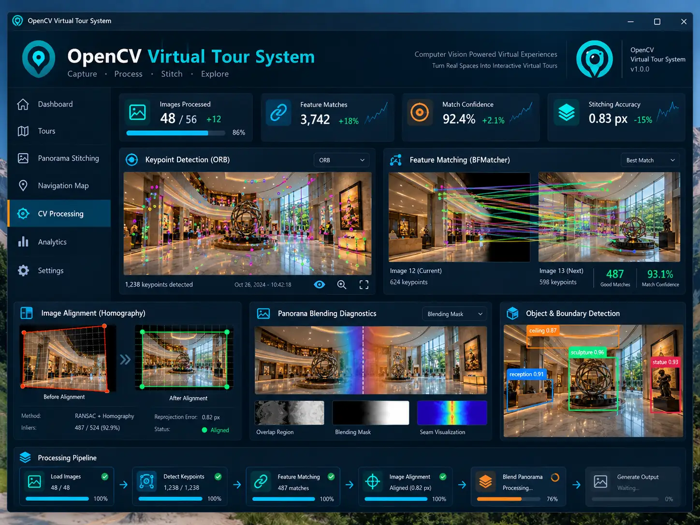
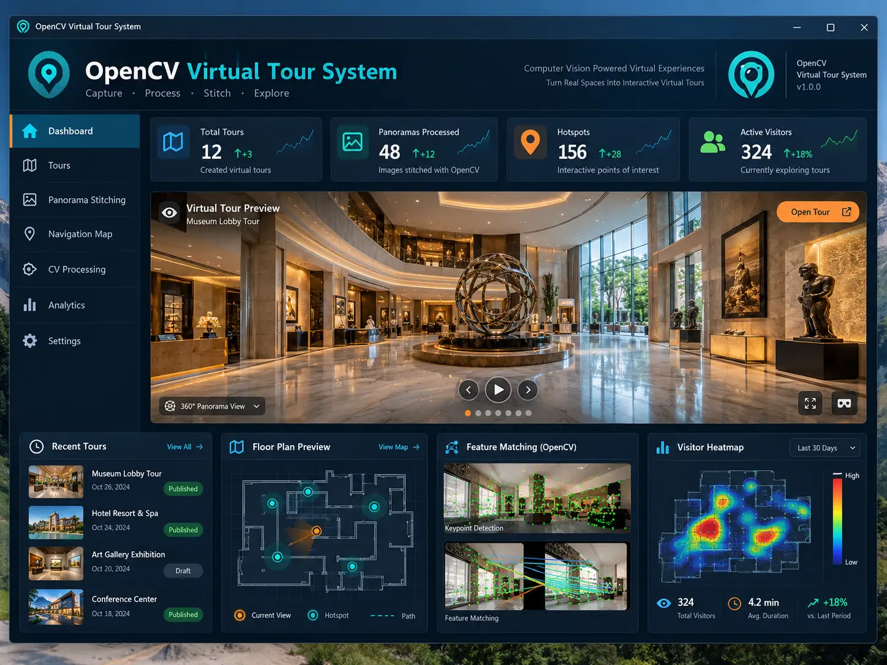
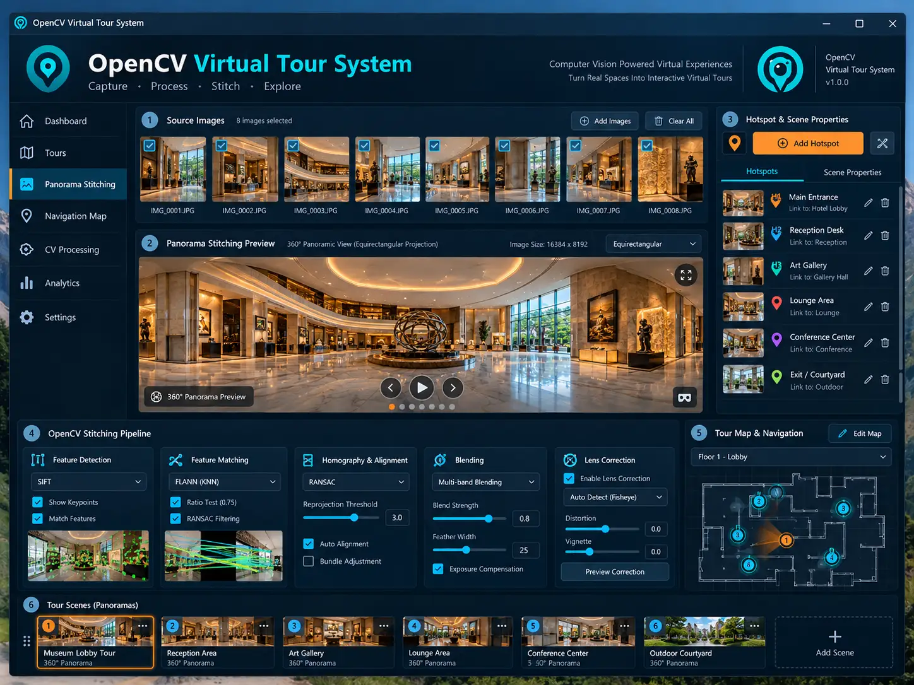
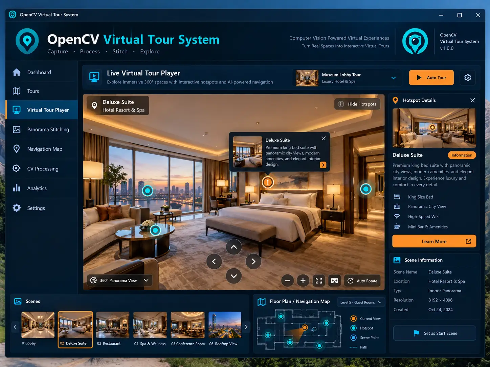
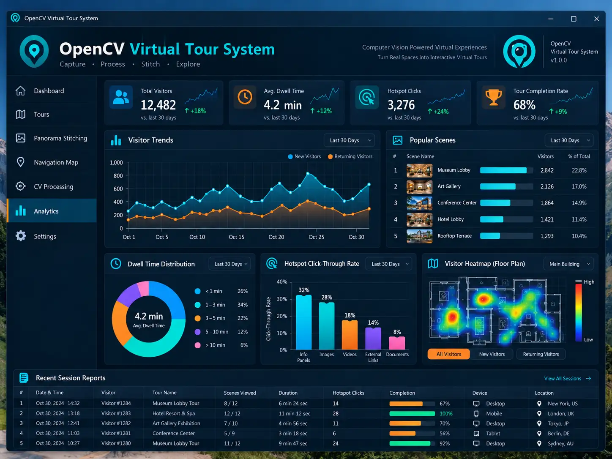

# VirtualTour Studio

An interactive virtual tour workbench inspired by the five supplied desktop screenshots. Includes procedural museum/hotel environments, a real 360° panorama player, scene and hotspot editing, a navigation map, local image processing, and browser activity analytics.

## Design reference gallery

The five supplied interface designs are shown below. These are design references; screenshots of the running application appear in [Running application screenshots](#running-application-screenshots).

### Computer vision processing



### Tour dashboard



### Panorama stitching workspace



### Interactive virtual tour player



### Visitor analytics



The images are stored as WebP copies for repository size. OpenCV labels, photographic imagery, feature overlays and visitor totals in these designs are reference content, not outputs of this implementation.

## Run

Requires Node.js 22+ and npm:

```sh
npm ci
npm run dev
# Open the localhost URL printed by Vite.
```

```sh
npm test
npm run build
npm run preview
```

Built with Three.js, Vite, Canvas, and a Web Worker. No API keys or backend are required. WebGL is required for immersive rendering; metadata editing, map navigation, analytics and image processing remain available without it.

## Explore and edit

- **Dashboard:** inspect the active space, open the player, select recent scenes, or navigate using the schematic map. Counters use the current project and actual local activity.
- **Tours:** add/edit/delete scenes, choose museum/gallery/suite/courtyard environments, and select the start scene. Deleting a scene also removes links pointing to it.
- **Virtual Tour Player:** drag to look around, scroll or use +/− to zoom, turn with arrow keys, toggle hotspots, rotate automatically, enter fullscreen, or capture a PNG. Auto Tour moves through scenes every 10 seconds.
- **Hotspots:** create scene links or information points. Enter yaw/pitch directly, or enable Click to Place Hotspot and select a position in the view. Hotspots can be edited or removed.
- **360° images:** upload a complete 2:1 equirectangular PNG/JPEG/WebP panorama for the current scene. Panoramas are rendered on an inside-facing sphere. Return to a procedural environment using the scene asset controls.
- **Navigation Map:** select scene markers to navigate; enable editing and drag markers to change their positions. Paths follow the actual hotspot links. The background is a schematic room diagram, not a measured floor plan.
- **Analytics:** review local scene-entry counts, observed hotspot clicks, scenes explored and recorded dwell time; export events as CSV. These are this browser's interactions, not external visitor statistics or unique-person counts.

Initial environments are generated 3D scenes with procedural materials and artwork, including a museum armillary sculpture, gallery, hotel suite and courtyard. They are not photogrammetry reconstructions or photographic copies of the reference screenshots. Scene-card thumbnails use schematic illustrations.

## Panorama and image processing

Open **Panorama Stitching**, add 2–8 source images in left-to-right order, or load the included synthetic gallery pair. Adjust the overlap and choose Process & Blend. You can inspect Harris corners, patch matches, a median-translation diagnostic and the feather-blended output, then export a PNG.

Processing runs in a cancellable worker:

1. Resize sources to a common 280-pixel working height.
2. Detect Harris corners and select separated high-score points.
3. Compare normalized 7×7 grayscale patches with nearest-neighbor ratio filtering and one-to-one target selection.
4. Estimate a median translation and calculate residuals for matches within six pixels.
5. Place images horizontally using the chosen overlap and apply linear feather blending.

The translation result is a diagnostic and is **not** used to warp the panorama. This is manual-overlap compositing, not a general-purpose automatic panorama stitcher. It does not perform homography/RANSAC, spherical registration, lens correction, bundle adjustment or multiband blending. Low-texture or rotated images may produce few reliable matches. CV Processing shows the actual computed values without fabricated confidence scores.

A blended output can be assigned to a 360° scene only when its aspect ratio is near 2:1; the user must ensure it contains a complete equirectangular view. Flat panoramas should be exported and viewed as flat images.

## Storage and project backups

Scene metadata and up to 2,000 local activity events autosave in localStorage. Uploaded panoramas are session assets and are not automatically stored there. Export Project JSON embeds the current panoramas as JPEG data URLs, together with validated scene metadata. Import restores both scenes and panoramas. Backups exclude activity events, stitching inputs and blend results; use CSV to save activity.

Panorama upload supports PNG/JPEG/WebP up to 12 MB / 32 megapixels, resized to a maximum width of 4096. Project files are limited to 32 MB and each embedded image to 5 million data-URL characters. Export adjusts JPEG quality to fit the image limit and rejects oversized project packages. Source stitching images are normalized to a height of 280 with a maximum working width of 1600; blends are limited to eight megapixels. The project supports up to 30 scenes with 30 hotspots per scene.

No server upload, hosting service, authentication, collaboration, external analytics, VR headset integration, OpenCV runtime, ORB/SIFT detector, semantic object detection or geographic tracking is bundled. Fullscreen depends on browser support. Existing panorama images can be explored in 360°; procedural rooms use a fixed viewpoint and scene navigation rather than free walking.

## Validation

Nine unit tests cover scene graph validation, invalid edits, deletion/link cleanup, actual activity aggregation, feather blending, corner detection, known-translation matching, project roundtrip and CSV escaping.

Optional production browser checks:

```sh
npm run build
python -m pip install playwright Pillow
python -m playwright install chromium
python tests/browser_check.py
# Or: CHROMIUM_PATH=/path/to/chromium python tests/browser_check.py
```

The browser test starts a temporary static server and captures the screenshots. It verifies WebGL environments, player rotation/zoom, hotspots, scene creation, fractional coordinates, click-to-place editing, start-scene persistence, map dragging, worker processing, blend exports, CV diagnostics, analytics CSV, built reference assets, project restore/rejection, panorama uploads and embedded-image roundtrips, scene deletion and mobile layout. Results: [browser-report.json](docs/browser-report.json). GitHub Actions runs unit tests and the production build.

## Code and commit history

- `src/model.js`: project validation, graph operations and analytics.
- `src/viewer.js`: procedural architecture, panorama rendering and interactive hotspots.
- `src/vision.js` / `src/worker.js`: actual image processing and feather blending.
- `src/app.js` / `src/style.css`: workbench, editing, persistence and exports.
- `tests/`: unit and production-browser validation.

The history records the actual implementation stages: graph/processing foundations, immersive workbench, backup and hotspot fixes with unit validation, then verified screenshots, documentation and CI. Commit dates reflect when the work was performed.
